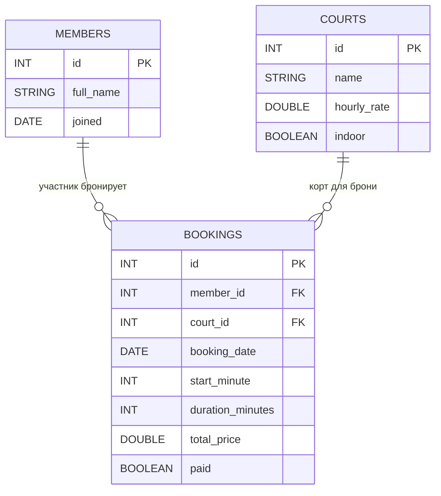
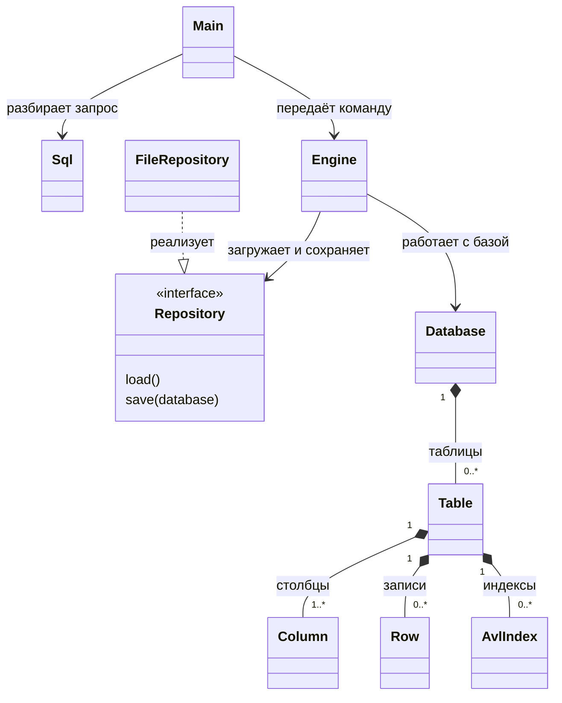
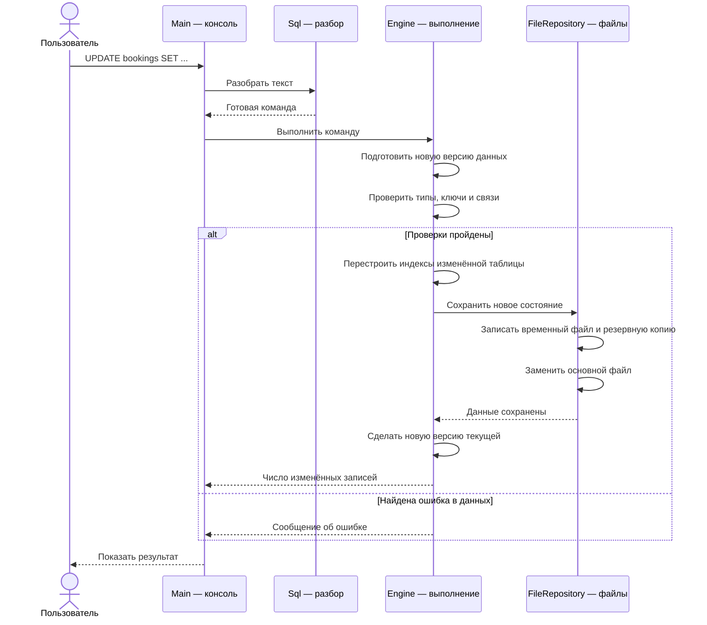
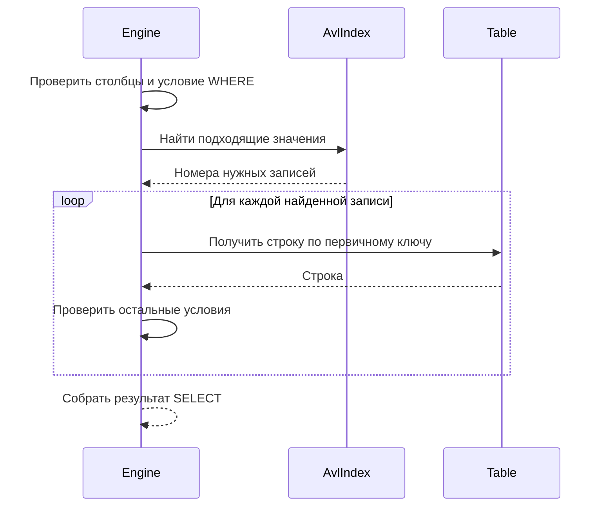

# Лабораторная работа № 2. Разработка упрощённой СУБД на Java

Цель работы — разработать систему управления базами данных с файловым хранением, обработкой SQL-подобных запросов и индексированием.

**TennisMiniDB** предназначена для учёта участников, кортов и бронирований теннисного центра. Программа предоставляет консольный интерфейс. Схемы таблиц, записи и индексы сохраняются на диск и восстанавливаются при запуске.

## 1. Реализованные возможности

- Три таблицы, связанные первичными и внешними ключами.
- Пять типов данных: целое число, число с плавающей точкой, строка, дата и логическое значение.
- Добавление одной или нескольких записей с проверкой уникальности первичного ключа.
- Выборка, обновление и удаление записей по условию.
- Вывод результатов в табличном виде.
- Поддержка `INSERT`, `SELECT`, `UPDATE`, `DELETE`, `CREATE TABLE` и `DROP TABLE`.
- Создание индексов через `CREATE INDEX` и их использование при выполнении SELECT.
- Сохранение данных и индексов, резервное копирование и проверка целостности файлов.
- Автоматические тесты, сравнение производительности и Javadoc в исходном коде.

Система позволяет создавать таблицы для других предметных областей. Примеры запросов с таблицей `cars` из задания приведены в `examples/cars.sql`.

## 2. Запуск программы

Для запуска требуется **Java 8 или новее**. Готовый файл программы находится в `build/tennis-minidb.jar`. Для изменения исходников и повторной сборки необходим **JDK 8+**, включающий компилятор. Внешние библиотеки и Maven не требуются.

В Windows необходимо распаковать архив, открыть PowerShell в папке `TennisMiniDB` и выполнить:

```powershell
.\run.bat
```

При первом запуске создаются три таблицы с демонстрационными записями и два индекса. При последующих запусках загружается сохранённая база. Каждая успешно выполненная изменяющая команда сохраняется на диск.

Проверить содержимое таблиц можно следующими запросами:

```sql
SELECT * FROM members;
SELECT * FROM courts;
SELECT * FROM bookings;
```

SQL-команды завершаются точкой с запятой. Допускается ввод одной команды на нескольких строках. Служебные команды вводятся отдельно, без точки с запятой:

| Команда | Назначение |
|---|---|
| `.help` | Справка по командам |
| `.tables` | Список таблиц |
| `.schema bookings` | Структура таблицы bookings |
| `.cancel` | Отмена незавершённого ввода |
| `.exit` | Завершение работы |

Для хранения отдельной базы используется параметр `--data`:

```powershell
.\run.bat --data my-database
```

Чтобы создать базу без демонстрационных данных, следует указать новый каталог и параметр `--empty`:

```powershell
.\run.bat --empty --data empty-database
```

Параметр `--empty` отключает начальное заполнение и не удаляет существующие данные.

Выполнение готовых SQL-сценариев:

```powershell
.\run.bat --data demo-session --script examples/demo.sql
.\run.bat --empty --data cars-session --script examples/cars.sql
```

Для повторного выполнения сценариев необходимо использовать новый каталог, чтобы избежать повторения первичных ключей. SQL-файлы читаются в кодировке UTF-8.

Прямой запуск JAR-файла, в том числе на Linux и macOS:

```text
java -Dfile.encoding=UTF-8 -jar build/tennis-minidb.jar
```

Сборка проекта в Windows:

```powershell
powershell -NoProfile -ExecutionPolicy Bypass -File .\build.ps1
```

Сборка с генерацией Javadoc:

```powershell
powershell -NoProfile -ExecutionPolicy Bypass -File .\build.ps1 -Docs
```

HTML-документация создаётся в `build/javadoc`. Проект также можно открыть в IntelliJ IDEA, выбрать JDK и запустить класс `tennisdb.Main`. Скрипты `.bat` и `.ps1` предназначены для Windows.

## 3. Структура базы данных

| Таблица | Содержимое |
|---|---|
| `members` | Номер участника, имя и дата регистрации |
| `courts` | Номер и название корта, стоимость часа и признак крытого корта |
| `bookings` | Номер бронирования, участник, корт, дата, время начала, длительность, стоимость и признак оплаты |

Таблица `bookings` связана с `members` по полю `member_id` и с `courts` по полю `court_id`. Одному участнику и одному корту может соответствовать несколько бронирований.

На диаграмме `PK` обозначает первичный ключ, `FK` — внешний ключ.



Поле `start_minute` хранит время в минутах от начала суток: например, 600 соответствует 10:00, а 720 — 12:00.

Для каждой таблицы требуется один первичный ключ из одного столбца. Его значение должно быть уникальным и не может быть NULL. Внешний ключ должен ссылаться на существующий первичный ключ того же типа.

Удаление или изменение первичного ключа участника либо корта запрещается, если на него ссылаются бронирования. Сначала необходимо удалить или изменить связанные записи. Удаление родительской таблицы запрещено, пока на неё ссылается другая таблица, даже если дочерняя таблица пуста.

## 4. Архитектура системы

Программа разделена на классы для консольного интерфейса, разбора запросов, выполнения операций, хранения данных и индексирования.

| Файл в `src/main/java/tennisdb` | Назначение |
|---|---|
| `Main.java` | Запуск программы, ввод команд и чтение SQL-файлов |
| `Sql.java` | Лексический и синтаксический разбор запросов |
| `Engine.java` | Выполнение команд, проверка условий и выбор индекса |
| `Database.java` | Каталог таблиц и проверка целостности данных |
| `Table.java` | Строки таблицы, первичные ключи и индексы |
| `Column.java`, `Row.java`, `DataType.java` | Описание столбцов, записей и типов данных |
| `AvlIndex.java` | Вторичный индекс на AVL-дереве |
| `Repository.java` | Интерфейс загрузки и сохранения базы |
| `FileRepository.java` | Файловое хранение, резервная копия и блокировка |
| `QueryResult.java`, `TablePrinter.java` | Результат запроса и табличный вывод |
| `Demo.java` | Начальная схема и демонстрационные данные |

### Диаграмма классов

`Main` передаёт текст запроса парсеру `Sql`, затем вызывает `Engine` для выполнения разобранной команды. Движок работает с базой `Database` и использует интерфейс `Repository` для загрузки и сохранения. Класс `FileRepository` реализует этот интерфейс для файлового хранения.



Паттерн Repository отделяет выполнение запросов от способа хранения. В программе используется файловая реализация, а в части тестов — реализация в памяти. Класс `Table` реализует `Iterable<Row>` и предоставляет Iterator для обхода записей. Классы `Row` и `Column` неизменяемы: при UPDATE создаётся новая запись. Объект `Sql.Command` хранит результат разбора запроса и передаётся движку.

### Диаграмма последовательности изменения данных

Изменяющая команда сначала выполняется над отдельной версией данных. После проверки типов, ключей и связей перестраиваются индексы изменённой таблицы и сохраняется новый снимок базы. Только после успешного сохранения новое состояние становится текущим.



При ошибке проверки или сохранения движок не заменяет текущее состояние в памяти. Вставка нескольких записей также проверяется как одна команда: ошибка в одной записи отменяет добавление остальных записей этой команды.

### Диаграмма последовательности SELECT с индексом

Индекс возвращает первичные ключи подходящих записей. Движок получает соответствующие строки, проверяет остальные условия и формирует результат запроса.



Диаграммы представлены в формате **Mermaid**. Их исходники доступны в `docs/diagrams` и могут редактироваться как текст. Для отображения схем необходим просмотрщик с поддержкой Mermaid.

## 5. Типы данных

| SQL-тип | Java-тип | Пример |
|---|---|---|
| `INT` | `Integer` | `12` |
| `DOUBLE` | `Double` | `1500.0` |
| `STRING` | `String` | `'Корт 1'` |
| `DATE` | `LocalDate` | `'2026-11-20'` |
| `BOOLEAN` | `Boolean` | `TRUE`, `FALSE` |

Также поддерживаются названия `INTEGER`, `FLOAT`, `TEXT`, `VARCHAR` и `BOOL` для соответствующих типов. `VARCHAR` указывается без параметра длины.

Строки и даты заключаются в одинарные кавычки. Числа и логические значения записываются без кавычек. Десятичный разделитель — точка. Одинарная кавычка внутри строки удваивается: `'O''Brien'`.

Для DATE проверяется корректность календарной даты. Значение `'2026-02-30'` отклоняется. Тип INT ограничен диапазоном знакового 32-битного Integer. Для DOUBLE допускаются только конечные значения; при сравнении необходимо учитывать погрешность представления дробных чисел.

Пропущенные столбцы при INSERT получают NULL. Для столбцов с ограничением NOT NULL и для первичного ключа это запрещено. Проверка отсутствующего значения выполняется через `IS NULL`, заполненного — через `IS NOT NULL`. Сравнение `= NULL` не выбирает строки.

## 6. Примеры запросов

Следующие команды рассчитаны на начальную базу. Первичные ключи 3, 4 и 5 должны быть свободны.

```sql
-- Добавление одной записи
INSERT INTO members VALUES (3, 'Мария Смирнова', '2026-11-14');

-- Добавление нескольких записей с указанием столбцов
INSERT INTO members (id, full_name) VALUES (4, 'Иван'), (5, 'Елена');

-- Добавление бронирования
INSERT INTO bookings VALUES (3, 3, 1, '2026-11-22', 600, 60, 1500.0, FALSE);

-- Выборка всех или отдельных столбцов
SELECT * FROM bookings;
SELECT id, total_price FROM bookings WHERE total_price > 1400;

-- Выборка по нескольким условиям
SELECT * FROM bookings WHERE court_id = 1 AND paid = FALSE;

-- Обновление и удаление
UPDATE bookings SET total_price = 1700.0, paid = TRUE WHERE id = 3;
DELETE FROM bookings WHERE id = 3;

-- Создание индекса и проверка плана выполнения
CREATE INDEX idx_bookings_price ON bookings (total_price);
EXPLAIN SELECT * FROM bookings WHERE total_price >= 1500;
DROP INDEX idx_bookings_price;
```

В WHERE поддерживаются операторы `=`, `!=`, `<>`, `<`, `<=`, `>`, `>=`, объединение условий через `AND` и проверки NULL. EXPLAIN показывает способ поиска и количество проверенных записей. Эти сведения также выводятся после обычного SELECT.

UPDATE и DELETE без WHERE применяются ко всем записям таблицы. Регистр названий таблиц, столбцов и индексов не учитывается; регистр строковых значений учитывается. Идентификаторы могут содержать латинские буквы, цифры и `_`, но не должны начинаться с цифры. Комментарий `--` действует до конца строки.

Пример создания и удаления таблицы:

```sql
CREATE TABLE notes (id INT PRIMARY KEY, text STRING);
INSERT INTO notes VALUES (1, 'Пример записи');
SELECT * FROM notes;
DROP TABLE notes;
```

Пример таблицы с внешним ключом:

```sql
CREATE TABLE member_notes (
    id INT PRIMARY KEY,
    member_id INT NOT NULL REFERENCES members(id),
    text STRING
);
```

## 7. Индексирование

Вторичный индекс реализован на AVL-дереве. Каждый узел содержит значение индексируемого столбца, множество первичных ключей соответствующих записей, высоту и ссылки на дочерние узлы. Повторяющиеся значения объединяются в одном узле. NULL в индекс не включается.

После вставки нового значения обновляются высоты и проверяется баланс дерева. При необходимости выполняются левый или правый повороты. Это сохраняет логарифмическую высоту, в том числе при добавлении значений в отсортированном порядке.

Поиск равенства выполняется по одной ветви. Для диапазонных условий `<`, `<=`, `>` и `>=` обходятся только подходящие части дерева. При D различных непустых значениях и K найденных записях сложность составляет O(log D + K). Полный просмотр N записей имеет сложность O(N).

Первичные ключи хранятся в `LinkedHashMap`, что позволяет проверять их уникальность и получать строки по ключу без полного просмотра. Вторичное AVL-дерево реализовано в `AvlIndex`, без использования TreeMap.

При нескольких условиях AND движок получает кандидатов по подходящим индексам и выбирает наименьший набор. Затем для найденных строк проверяются все условия запроса. Для `!=`, `<>` и проверок NULL выполняется полный просмотр. При выборке значительной части таблицы индекс может не дать выигрыша.

После INSERT, UPDATE и DELETE индексы изменённой таблицы перестраиваются целиком. Это упрощает поддержание согласованности, но увеличивает время записи. При запуске сохранённые деревья восстанавливаются из файла без повторного построения.

## 8. Хранение и восстановление данных

По умолчанию файлы базы создаются в каталоге `data`:

| Файл | Назначение |
|---|---|
| `database.bin` | Текущий снимок базы |
| `database.bak` | Предыдущий сохранённый снимок |
| `database.tmp` | Подготавливаемый новый снимок |
| `backup.tmp` | Временный файл резервной копии |
| `database.lock` | Межпроцессная блокировка |

Схема, записи и индексы сериализуются в один общий снимок. Классы данных реализуют `Serializable`; запись и чтение выполняются через `ObjectOutputStream` и `ObjectInputStream`. Узлы индексов входят в `database.bin`, поэтому отдельный файл `.idx` не требуется.

Новый снимок сначала записывается во временный файл. Затем буферы сбрасываются через `FileDescriptor.sync()`, предыдущий корректный снимок сохраняется в резервную копию и заменяется основной файл. Для замены используется `ATOMIC_MOVE`, если файловая система поддерживает эту операцию; иначе выполняется обычная замена.

Заголовок содержит обозначение формата, версию, длину данных и контрольную сумму SHA-256. При загрузке эти сведения проверяются для обнаружения повреждённого или неполного файла.

Если основной снимок недоступен, программа загружает резервную копию и выводит сообщение. Поскольку копия содержит предыдущее состояние, возможно потерять последнюю команду. Если оба снимка непригодны, запуск прекращается, а файлы сохраняются без перезаписи. Незавершённый временный файл не считается зафиксированным состоянием.

Доступ к одной базе одновременно предоставляется одному процессу. Блокировка устанавливается через `FileChannel.tryLock()` и освобождается операционной системой при завершении процесса. Наличие файла `database.lock` после выхода не означает, что блокировка продолжает действовать.

## 9. Тестирование

Запуск автоматических проверок:

```powershell
.\test.bat
```

Выполнены **17 групп тестов и 388 успешных проверок**. Протокол сохранён в `reports/tests.txt`. Исходники скомпилированы компилятором Java 17.0.10 с параметром `--release 8`; программа и тесты запущены на Java 8u351.

Проверены:

- Поддерживаемые типы, некорректные значения и ограничения NULL/NOT NULL.
- Уникальность первичных ключей и соблюдение внешних ключей.
- Добавление нескольких записей, обновление и удаление по условию.
- Отмена всей команды при ошибке в одной из записей.
- Ошибки синтаксиса, экранирование кавычек и комментарии.
- Совпадение результатов индексного поиска и полного просмотра.
- Актуальность индекса после изменений и его восстановление при запуске.
- Повреждение снимков, ошибки записи и запрет второго открытия базы.

AVL-дерево дополнительно проверено на случайных данных с повторяющимися значениями. Результаты сравнивались с последовательным поиском. Проверялись порядок ключей, высоты и баланс дерева, а также вставка 10 000 отсортированных значений.

Для проверки аварийного завершения используется отдельный процесс `CrashProbe`. После сохранения записи он вызывает `Runtime.halt(37)` без обычного закрытия ресурсов. При последующем открытии запись и индекс восстанавливаются. Незавершённый временный файл проверяется отдельным тестом. Отключение питания во время записи не моделировалось.

Результаты выполнения SQL-сценариев находятся в `reports/demo-output.txt` и `reports/cars-output.txt`.

## 10. Сравнение производительности

Измерения выполнены 14 ноября 2026 года для баз на 1 000, 10 000 и 100 000 записей. Повторный запуск:

```powershell
.\benchmark.bat
```

Сравнивалось выполнение одного запроса с использованием индекса и при принудительном полном просмотре:

```sql
SELECT id, total_price FROM bookings WHERE booking_date = '2026-05-08';
```

Тестовые данные содержали 1000 равномерно распределённых дат. Запрос выбирал 0,1% записей. Перед измерением база и индекс сохранялись и повторно загружались с диска. Совпадение результатов двух способов проверялось отдельно.

Сначала выполнялось по 80 прогревочных запросов каждым способом. Затем проводилось семь серий по 100 запросов с чередованием порядка способов. Время измерялось через `System.nanoTime()` и делилось на число запросов в серии. Из семи средних времён выбиралась медиана. В таблице указаны микросекунды на один запрос.

| Записей | Найдено | Без индекса, мкс | С индексом, мкс | Ускорение |
|---:|---:|---:|---:|---:|
| 1 000 | 1 | 95,524 | 12,660 | 7,55× |
| 10 000 | 10 | 447,681 | 5,164 | 86,69× |
| 100 000 | 100 | 4 291,554 | 13,881 | 309,17× |

На 100 000 записей полный просмотр проверил все строки, а индексный поиск — 100 подходящих записей. Высота AVL-дерева во всех случаях составила 10, поскольку количество различных дат оставалось постоянным.

В измерение входили поиск, проверка условий и получение выбранных столбцов. Создание данных, чтение снимка, построение индекса, разбор SQL и печать результата не учитывались. Для отключения индексов использовался параметр движка `forceScan=true`.

Результаты серий сохранены в `reports/benchmark-runs.csv`, сводная таблица — в `reports/benchmark.csv`, сведения о среде — в `reports/benchmark-environment.txt`.

Результаты зависят от прогрева JVM, сборки мусора и нагрузки на компьютер. Полученное ускорение относится к запросу с небольшой выборкой. При чтении почти всей таблицы или частом изменении данных преимущество может уменьшиться. Время построения и сохранения индекса в это сравнение SELECT не включено.

## 11. Ограничения реализации

Поддерживается указанное подмножество SQL-подобного языка. JOIN, OR, ORDER BY, агрегатные функции, подзапросы, ALTER TABLE, DEFAULT, составные ключи и скобки вокруг условий не реализованы. Внешний ключ задаётся рядом со столбцом через REFERENCES; табличная форма `FOREIGN KEY (...)` не поддерживается. Неподдерживаемые конструкции отклоняются с ошибкой.

Порядок строк SELECT не гарантируется. В режиме SQL-файла первая ошибка останавливает выполнение, но предыдущие успешные команды остаются сохранёнными. В интерактивном режиме после ошибки можно продолжить работу.

База загружается в память целиком. Каждая изменяющая команда сохраняет полный снимок и перестраивает индексы изменённой таблицы. Лимит содержимого снимка составляет 256 MiB; для копирования и сериализации требуется дополнительная память.

Пользовательские транзакции BEGIN/COMMIT/ROLLBACK и журнал WAL не реализованы. Резервная копия повышает надёжность, однако сохранность последней команды при отключении питания не гарантируется, особенно при отсутствии атомарной замены файлов.

Проверка пересечений времени бронирований и автоматический расчёт стоимости не входят в реализацию. В работе рассматриваются механизмы СУБД: таблицы, типы, ключи, запросы, файлы и индексы.

## 12. Выводы

Разработана упрощённая СУБД с поддержкой типизированных таблиц, первичных и внешних ключей, SQL-подобных запросов и файлового хранения. Данные и индексы восстанавливаются между запусками. Разделение классов по назначению и использование Repository позволяют проверять выполнение запросов независимо от файловой системы.

Измерения показали преимущество AVL-индекса для запросов с небольшой выборкой. При этом индекс требует дополнительной памяти и времени на перестроение. Полное сохранение снимка упрощает согласованность данных, но ограничивает размер базы и производительность изменяющих операций.

## 13. Использованные источники

1. [Java SE 8: Serializable](https://docs.oracle.com/javase/8/docs/api/java/io/Serializable.html).
2. [Java Object Serialization Specification: Object Output Classes](https://docs.oracle.com/javase/8/docs/platform/serialization/spec/output.html).
3. [Java SE 8: Files](https://docs.oracle.com/javase/8/docs/api/java/nio/file/Files.html).
4. [Java Tutorials: Moving a File or Directory](https://docs.oracle.com/javase/tutorial/essential/io/move.html).

Основанием для разработки является задание на лабораторную работу № 2. Предметная область выбрана на основе предыдущей работы по теннисному центру; текущая реализация выполнена на Java.
